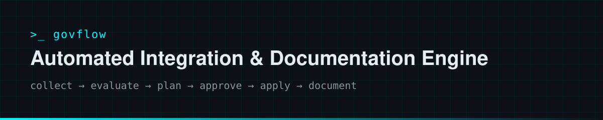
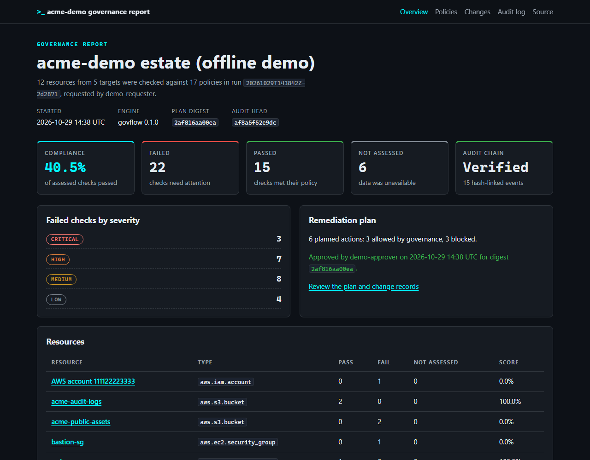
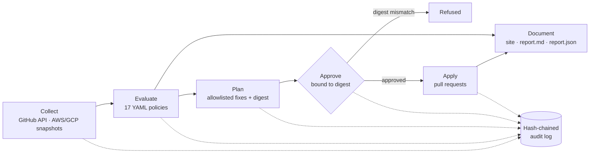

<div align="center">



**Governed IT automation: integrates with GitHub and cloud configuration, enforces policy-as-code behind an approval gate, records every step in a tamper-evident audit trail and writes its own compliance documentation.**

[](https://github.com/CYSECPRP/automated-integration-documentation-engine/actions/workflows/ci.yml)
[](https://github.com/CYSECPRP/automated-integration-documentation-engine/actions/workflows/govern.yml)


[](LICENSE)

[**Live governance report**](https://cysecprp.github.io/automated-integration-documentation-engine/) ·
[**Offline demo report**](https://cysecprp.github.io/automated-integration-documentation-engine/demo/) ·
[Architecture](docs/architecture.md) ·
[Design decisions](docs/adr/)

</div>

> [!NOTE]
> This is an open-source rebuild of the automated compliance scanning tool I built at the
> **DSU Cybersecurity Hackathon**, where it placed **2nd Runner-up**. The idea is the same; the
> code here was written from scratch with tests, CI and a real, scheduled deployment.

## Why

Compliance work is usually three disconnected jobs: someone runs a scanner, someone else fixes
what it finds, and someone writes documentation for the auditors afterwards. The fixes are made
without a record of who approved them, and the documentation is out of date the day it is written.

`govflow` turns that into one governed pipeline:

- **Integrate** with the systems you already run: the GitHub REST API (live, read-only) and
  AWS / GCP configuration snapshots (offline JSON exports).
- **Evaluate** every resource against declarative YAML policies mapped to OpenSSF Scorecard,
  CIS benchmarks and vendor guidance. Missing permissions produce *not assessed*, never a guess.
- **Plan** remediation, but only for actions and targets that governance explicitly allows.
- **Approve** the exact plan that was reviewed: approvals are bound to a SHA-256 digest of it.
- **Apply** approved changes as pull requests, never as direct pushes.
- **Document** everything as a static evidence site, a Markdown report and JSON, generated from
  the same run data, with a hash-chained audit log that proves nothing was edited afterwards.



## How a run works



Every command reads and writes one **run directory**, so each step can be reviewed, re-run or
handed to someone else:

| File | Written by | Contents |
| --- | --- | --- |
| `run.json` | `scan` | Run id, actor, engine version, config digest, targets |
| `resources.json` | `scan` | Normalized resources, including which fields were unavailable and why |
| `findings.json` | `scan` | One finding per policy and resource: pass, fail or not assessed, with evidence |
| `plan.json` | `scan` | Planned actions, allowed or blocked (with the reason), and the plan digest |
| `approval.json` | `approve` | Approver, comment, time and the digest they approved |
| `changes.json` | `apply` | Change records: dry-run, simulated, applied, skipped or failed |
| `audit.jsonl` | every step | Append-only events, each holding the SHA-256 of the previous one |

## Governance model

1. **Allowlists.** A failed check with a remediation action becomes a planned action. It is only
   *executable* when both the action type (`governance.allowed_actions`) and the target
   (`governance.allowed_targets`) are allowlisted; everything else is recorded as blocked, with
   the reason, and left to a human.
2. **Digest-bound approval.** The plan digest covers the run id and every planned action.
   `govflow approve --digest <digest>` must quote it, so an approval cannot be reused for a
   different or modified plan. With `separation_of_duties: true` the approver must differ from
   the person who requested the run.
3. **Safe by default.** `apply` is a dry run. `--simulate` exercises the approval gate without
   changing anything. `--execute` needs a matching approval and a token, and opens one pull
   request per action on a new `govflow/<run-id>/<action>` branch, together with a change record
   under `docs/governance/changes/`. Files that already exist are skipped, never overwritten.
4. **Tamper evidence.** Every step appends to `audit.jsonl`. `govflow audit verify` recomputes the
   chain and detects edited, deleted or reordered events. Loading a run also checks that
   `plan.json` still matches the digest recorded in the audit log.

In this repository the weekly [`govern.yml`](.github/workflows/govern.yml) workflow scans my
public repositories, publishes the report to GitHub Pages and stores the audit trail on the
[`evidence`](https://github.com/CYSECPRP/automated-integration-documentation-engine/tree/evidence)
branch, chaining each run to the previous one. If the plan contains executable actions, the
`remediate` job waits in a protected `remediation` environment; the reviewer who approves that
deployment is recorded as the approver of the plan digest before any pull request is opened.
The workflow token cannot read administration settings, so GH-008 to GH-010 are reported as
*not assessed* unless an optional read-only `GOVFLOW_SCAN_TOKEN` secret is configured.

## Quick start

The demo runs the whole pipeline offline against bundled fixtures (three GitHub repositories, an
AWS account and a GCP project). No token or network access is needed after installation.

```bash
# With uv installed: run the demo straight from GitHub
uvx --from git+https://github.com/CYSECPRP/automated-integration-documentation-engine govflow demo

# Or from a clone
git clone https://github.com/CYSECPRP/automated-integration-documentation-engine
cd automated-integration-documentation-engine
uv sync
uv run govflow demo
```

Open `govflow-demo/site/index.html` to explore the generated report.

### Govern your own repositories

```bash
# Optional for public repositories (unauthenticated requests are rate limited).
export GOVFLOW_GITHUB_TOKEN=<fine-grained token>

uv run govflow scan --config govflow.yaml --out runs
uv run govflow plan show runs/<run-id>
uv run govflow approve runs/<run-id> --approver <name> --digest <plan-digest>
uv run govflow apply runs/<run-id>             # dry run
uv run govflow apply runs/<run-id> --execute   # opens pull requests
uv run govflow docs runs/<run-id> --site site
uv run govflow audit verify runs/<run-id>
```

| Token permission (fine-grained) | Needed for |
| --- | --- |
| Metadata: read, Contents: read | Scanning |
| Administration: read | GH-008, GH-009 and GH-010 (otherwise reported as *not assessed*) |
| Contents: write, Pull requests: write | `apply --execute`, on allowlisted repositories only |

### Configuration

```yaml
version: 1
name: Platform team estate
targets:
  github:
    repositories:
      - my-org/payments-api
      - my-org/docs-site
  snapshots:                     # offline AWS / GCP exports, relative to this file
    - snapshots/aws.json
policies:
  include_builtin: true
  paths: [policies/]             # your own policies, same format as the built-in ones
governance:
  separation_of_duties: true     # approver must not be the requester
  allowed_actions: [github.add_file]
  allowed_targets: ["github:my-org/payments-api"]
  fail_on: high                  # exit 1 if a high or critical check fails
docs:
  title: Platform governance report
  links:
    - label: Runbook
      href: https://example.com/runbook
```

Cloud snapshots use the `govflow-snapshot/v1` format: a provider (`aws` or `gcp`), a scope
(account or project) and a list of resources with their attributes. See
[`demo_data/aws_snapshot.json`](src/govflow/demo_data/aws_snapshot.json) for a complete example.

### Exit codes

| Code | Meaning |
| --- | --- |
| `0` | Success |
| `1` | A check failed at or above the `fail_on` severity |
| `2` | Usage or configuration error |
| `3` | Governance or integrity error: refused approval, digest mismatch, broken audit chain |
| `4` | Integration error while collecting from a target |

## Policies

Policies are YAML files with a safe, declarative condition language (comparisons, `all` / `any` /
`not`, and quantifiers over lists) that is validated when loaded. No code is ever evaluated.

| ID | Severity | Check | Automated fix |
| --- | --- | --- | --- |
| GH-001 | high | Default branch is protected against deletion and force pushes | |
| GH-002 | medium | Repository publishes a security policy | Pull request adding `SECURITY.md` |
| GH-003 | medium | Dependency updates are automated | Pull request adding `dependabot.yml` |
| GH-004 | low | Code owners are defined | Pull request adding `CODEOWNERS` |
| GH-005 | low | Repository declares a license | |
| GH-006 | high | Workflow actions are pinned to full commit SHAs | |
| GH-007 | medium | Workflows declare least-privilege token permissions | |
| GH-008 | high | Secret scanning and push protection are enabled | |
| GH-009 | high | Dependabot vulnerability alerts are enabled | |
| GH-010 | medium | Default GitHub Actions token is read-only | |
| AWS-001 | high | S3 bucket blocks all public access | |
| AWS-002 | medium | S3 bucket versioning is enabled | |
| AWS-003 | critical | Security group does not expose SSH or RDP to the internet | |
| AWS-004 | critical | Root user has MFA enabled | |
| GCP-001 | high | Cloud Storage bucket is not publicly accessible | |
| GCP-002 | medium | Uniform bucket-level access is enabled | |
| GCP-003 | critical | Firewall rule does not expose SSH or RDP to the internet | |

Every policy carries its rationale, step-by-step remediation and framework references, which the
generated runbooks render for each failed check. Example:

```yaml
id: GH-002
title: Repository publishes a security policy
resource: github.repository
severity: medium
rationale: A SECURITY.md tells researchers how to report vulnerabilities privately.
check:
  path: files.security_policy
  op: eq
  value: true
remediation:
  steps:
    - Add SECURITY.md to the repository root, .github/ or docs/.
  action: github.add_file
  params: {path: SECURITY.md, template: security_md}
references:
  - framework: OpenSSF Scorecard
    control: Security-Policy
```

## Security

- Read-only unless `apply --execute` is used with an approval that matches the plan digest.
- Tokens come from the environment only and never appear in output, errors or `repr()`.
- The generated site is autoescaped and ships a restrictive Content Security Policy; configured
  links must be `https://` or relative.
- YAML is loaded with `safe_load`; the condition language is parsed, not evaluated.
- The workflows pin every action to a commit SHA and grant permissions per job.

See [SECURITY.md](SECURITY.md) to report a vulnerability.

## Development

```bash
uv sync
uv run ruff check . && uv run ruff format --check .
uv run mypy          # strict
uv run pytest        # 116 tests, coverage gate 85%
```

```text
src/govflow/
├── cli.py               Typer CLI and exit codes
├── workflow.py          scan → approve → apply orchestration
├── connectors/          GitHub REST client, cloud snapshots, offline fixtures
├── expressions.py       safe condition language
├── policy_engine.py     loading and evaluating policies
├── governance.py        planning, allowlists, approvals
├── actions/             executors (pull requests, simulation) and file templates
├── audit.py             hash-chained audit log
├── docs_engine.py       static site, Markdown and JSON reports
├── policies/            built-in GitHub, AWS and GCP policies
└── templates/           Jinja templates for the site and reports
```

## Roadmap

- Live AWS and GCP connectors next to the snapshot format
- SARIF output so findings appear in GitHub code scanning
- More remediation actions, such as enabling Dependabot alerts through the API
- Notifications when a run fails its `fail_on` threshold

## License

[MIT](LICENSE) © 2026 Prajwal R Pattanshetti
