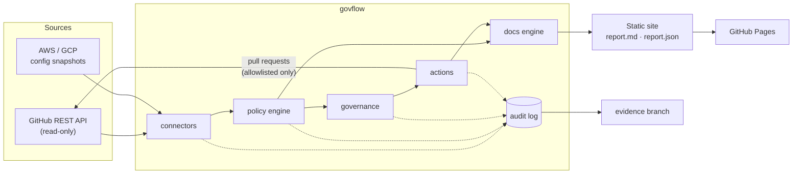
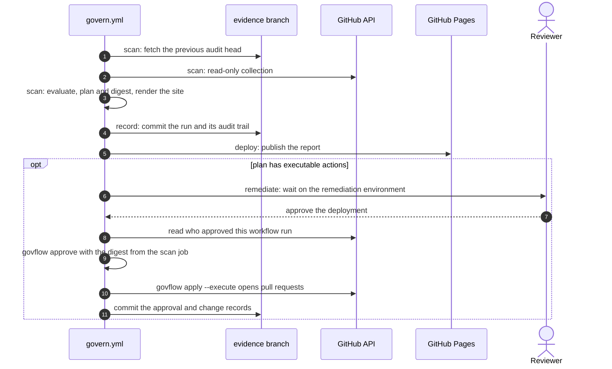

# Architecture

`govflow` is a small, dependency-light Python package. Each stage of a run is a pure function of
the previous stage's files, so a run can be inspected, verified or resumed by anyone who has the
run directory.

## Context

## Components

| Module | Responsibility |
| --- | --- |
| `connectors/github.py` | GitHub REST client (pagination, rate-limit back-off, token hygiene) and the collector that turns a repository into a `github.repository` resource. Data that needs admin access is marked *unavailable* with a reason instead of being guessed. |
| `connectors/snapshots.py` | Loads `govflow-snapshot/v1` JSON exports for AWS and GCP and validates the resource types. |
| `connectors/fixtures.py` | Serves recorded API responses through an `httpx.MockTransport`, so the demo and tests exercise the real client code. |
| `expressions.py` | Parses the declarative condition language into an AST and evaluates it with three-valued logic (true, false, unknown). |
| `policy_engine.py` | Loads and validates policies, evaluates every policy against every matching resource and records evidence for each finding. |
| `governance.py` | Builds the remediation plan, classifies each action against the allowlists, computes the plan digest and enforces approval rules. |
| `actions/` | Executors. `github_pr.py` opens a pull request per action; `SimulatedExecutor` exercises the gate without side effects. |
| `audit.py` | Append-only JSONL log where each event stores the SHA-256 of its predecessor, plus the verifier. |
| `workflow.py` | Orchestrates `scan`, `approve` and `apply`, and writes the run directory. |
| `docs_engine.py` | Renders the static site, `report.md` and `report.json` from a run with Jinja (`StrictUndefined`, autoescaped HTML). |
| `cli.py` | Typer command line interface, exit codes and GitHub Actions outputs. |

## Data flow

1. **Collect.** Each connector returns `Resource` objects with normalized `attributes`, an
   `unavailable` map (field path to reason) and collection errors. Errors are reported per target
   and do not abort the run.
2. **Evaluate.** Every policy whose `resource` type matches produces one `Finding`: `pass`,
   `fail` or `not_assessed`. A check whose result depends on unavailable data is *not assessed*,
   and the finding explains which data was missing and why.
3. **Plan.** Failed findings whose policy declares a `remediation.action` become
   `PlannedAction`s. An action is allowed only if its type and target are both allowlisted.
   The plan digest is SHA-256 over the canonical JSON of the run id and all actions.
4. **Approve.** An `Approval` names the approver and the digest they reviewed. It is refused if
   the digest differs from the current plan, if nothing is executable, or if separation of duties
   is enabled and the approver is the requester.
5. **Apply.** Dry run by default. With `--execute`, every allowed action is executed once and
   produces a `ChangeRecord`; already-applied actions are skipped on re-runs.
6. **Document.** The docs engine renders the run, including the plan, approvals, change records
   and the verified audit chain.

## The approval gate in CI

The `remediate` job only receives the plan digest from the `scan` job. If the run directory had
been altered between jobs, loading it would fail the digest and audit-chain checks before
anything is applied.

## Threat model

| Threat | Mitigation |
| --- | --- |
| Automation makes changes nobody approved | Read-only by default; actions and targets must be allowlisted; execution requires an approval for the exact plan digest; changes are pull requests, not pushes. |
| A plan is modified after it was reviewed | The approval quotes the digest; `load_run` recomputes it and compares it with the `plan.created` audit event. |
| Evidence is edited after the fact | Hash-chained audit log; `govflow audit verify` detects edited, deleted or reordered events; weekly runs chain to the previous head stored on the `evidence` branch. |
| Token leakage | Tokens are read from the environment only and are excluded from `repr()`, error messages and output. |
| Malicious configuration or policy content | Strict Pydantic models (`extra="forbid"`), `yaml.safe_load`, an expression language that is parsed rather than evaluated, and links restricted to `https://` or relative paths. |
| Script injection into the generated site | HTML autoescaping, Markdown escaping of untrusted values and a restrictive Content Security Policy. |
| Supply chain compromise in CI | Actions pinned to commit SHAs, per-job least-privilege permissions, `uv sync --locked` against a lock file, and Dependabot updates with a cooldown. |
| Workflow script injection | All `${{ }}` values reach shell scripts through environment variables. |

### Known limitations

- The audit chain proves integrity relative to a trusted head. Someone with write access to the
  `evidence` branch could rewrite the whole chain; the head is also published in the report and in
  the workflow artifacts, which makes that visible. Signing the head is a natural next step.
- Snapshot files are trusted input; `govflow` validates their structure, not their provenance.
- The workflow token cannot read administration settings, so GH-008 to GH-010 stay
  *not assessed* unless a token with Administration: read is supplied.
